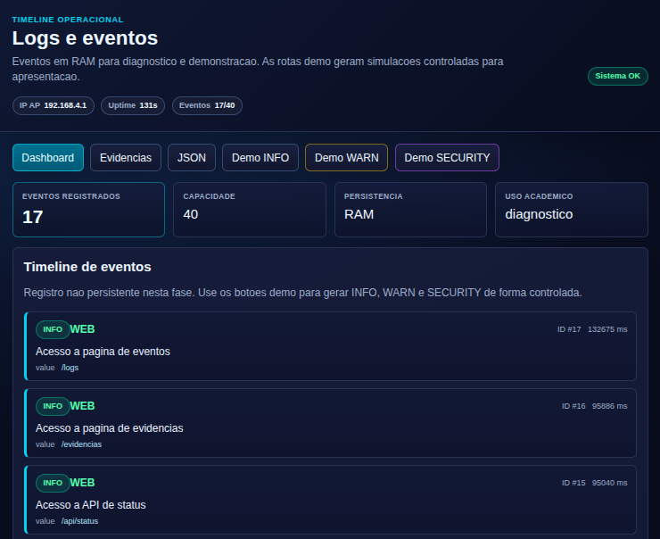
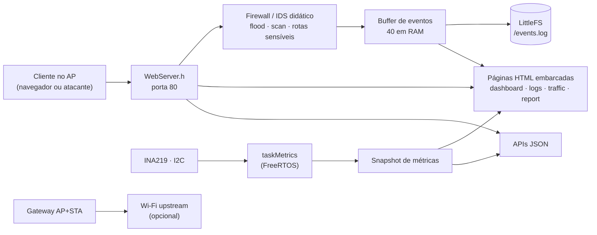

# ESP32 Mini Firewall Gateway

[](https://github.com/MarcoRodrigues00/ESP32-Mini-Firewall-Gateway/actions/workflows/firmware.yml)

Monitor de segurança ciberfísico rodando num **ESP32 real**: o próprio microcontrolador sobe um ponto de acesso Wi-Fi, serve um dashboard web embarcado e registra, em tempo real, flood HTTP, varredura de rotas, acessos a caminhos sensíveis e telemetria de energia (INA219). Tudo em C++ com FreeRTOS, sem nuvem e sem CDN.

Projeto da disciplina Performance de Sistemas Ciberfísicos (PUCPR). É um sistema **didático de laboratório**: detecta e registra, mas não substitui firewall, IDS/IPS ou roteador profissional.



## O que ele faz

- **Ponto de acesso próprio** (`ESP32-Firewall-Lab`, `192.168.4.1`) em modo AP+STA, com Wi-Fi upstream opcional configurável pela web, sem regravar o firmware.
- **Firewall/IDS didático sobre HTTP:** mais de 20 requisições em 10 s geram evento `SECURITY` de flood; 5 respostas 404 em 15 s indicam varredura; acessos a caminhos como `/admin`, `/wp-admin` e `/etc/passwd` viram eventos do IDS.
- **Monitor de tráfego** (`/traffic`): total de requisições, 404, rotas sensíveis, último IP, User-Agent resumido e rotas mais acessadas.
- **Eventos em quatro níveis** (`INFO`, `WARN`, `ERROR`, `SECURITY`): buffer circular de 40 eventos em RAM e persistência seletiva em LittleFS.
- **Telemetria de energia** com INA219 (tensão, corrente e potência), lida em segundo plano; se o sensor não estiver ligado, o sistema segue funcionando e mostra `n/d`.
- **Métricas de performance:** uptime, heap livre e mínimo, flash, tasks do FreeRTOS e tempo de execução das funções principais.
- **APIs JSON** (`/api/status`, `/api/events`, `/api/traffic`, `/api/report`) e um relatório técnico embarcado em `/report`.

## Arquitetura



Três tasks do FreeRTOS, fixadas por núcleo (`xTaskCreatePinnedToCore`): `taskWebServer` atende o HTTP, enquanto `taskMetrics` e `taskHeartbeat` rodam no outro núcleo. As requisições leem um **snapshot** das métricas, e só a task de métricas fala com o barramento I2C. Assim, uma página nunca fica esperando o sensor.

Mais detalhes em [docs/arquitetura-tecnica.md](docs/arquitetura-tecnica.md) e [docs/ARQUITETURA.md](docs/ARQUITETURA.md).

## Decisões de engenharia

| Decisão | Por quê |
|---|---|
| Sem `delay()` no fluxo principal; tasks com `vTaskDelay` | o servidor web continua respondendo enquanto as métricas são coletadas |
| Snapshot de métricas em memória | requisições HTTP não tocam no I2C nem disputam o sensor |
| Persistir só `WARN`, `ERROR`, `SECURITY` e eventos de sistema | evita desgastar a flash gravando cada acesso comum |
| Rotação do `/events.log` em 16 KB | limite previsível de armazenamento, sem risco de encher o LittleFS |
| Senha do AP fora do código (`include/secrets.h`, ignorado pelo git) | o firmware não compila sem ela, e nenhuma credencial vai para o repositório |
| Passphrase upstream nunca exibida em HTML, API, logs ou Serial | a interface só informa se existe uma passphrase salva |
| Saídas HTML escapadas | rotas e eventos vêm de quem faz a requisição; sem escape, viram XSS no painel |

Controles de segurança, riscos conhecidos e o que mudaria em produção: [docs/HARDENING.md](docs/HARDENING.md).

## Hardware

| Componente | Uso | Situação |
|---|---|---|
| ESP32 DevKit (`esp32dev`) | microcontrolador, AP Wi-Fi e servidor web | em uso |
| INA219 (I2C: SDA `GPIO 21`, SCL `GPIO 22`) | tensão, corrente e potência | em uso |
| DHT22 e MQ-2 | temperatura/umidade e gás | planejado |
| Relé 5 V e ventoinha 5 V (nunca direto no GPIO) | atuadores | planejado |
| Botão físico com interrupção | alternar modo de contenção | planejado |

Ligações e cuidados elétricos: [docs/HARDWARE.md](docs/HARDWARE.md).

## Como compilar e gravar

Requisitos: [PlatformIO](https://platformio.org/) e um ESP32 DevKit.

```bash
# 1. Defina a senha do AP de laboratório (o arquivo fica fora do git)
cp include/secrets_example.h include/secrets.h
#    edite include/secrets.h e troque LAB_AP_PASSPHRASE (8 a 63 caracteres)

# 2. Compile e grave
pio run
pio run -t upload

# 3. Acompanhe o boot
pio device monitor -b 115200
```

Depois conecte no Wi-Fi `ESP32-Firewall-Lab` e abra `http://192.168.4.1/`.

O CI compila o firmware em todo push e pull request. Passo a passo de operação e recuperação: [docs/RUNBOOK.md](docs/RUNBOOK.md).

## Rotas

| Rota | O que mostra |
|---|---|
| `/` | dashboard com performance, firewall, clientes, logs, configuração, sobre e changelog |
| `/logs` (ou `/eventos`) | timeline de eventos por severidade |
| `/traffic` | monitor de tráfego HTTP |
| `/gateway` e `/wifi` | estado AP+STA e configuração do upstream |
| `/report` e `/evidencias` | relatório técnico para apresentação |
| `/demo` | roteiro guiado, com `/demo/flood`, `/demo/ids` e `/demo/scan` gerando eventos controlados |
| `/api/status`, `/api/events`, `/api/events/persistent`, `/api/traffic`, `/api/report` | dados em JSON |

Referência completa com os campos de cada API: [docs/api-reference.md](docs/api-reference.md).

## Testes e evidências

- **Smoke test HTTP** contra a placa real, gerando relatório em Markdown: `python3 tools/smoke_test_http.py --base-url http://192.168.4.1` ([docs/smoke-test.md](docs/smoke-test.md)).
- **Checagem offline** (build, rotas registradas, documentação mínima) sem precisar estar conectado ao AP: `python3 tools/offline_project_check.py` ([docs/offline-check.md](docs/offline-check.md)).
- **Evidências de bancada** (prints, respostas das APIs e relatórios) em [`evidencias/`](evidencias/), com o roteiro em [docs/evidencias.md](docs/evidencias.md).

## Limitações

- Detecta e registra; **não bloqueia** tráfego. O firewall observa apenas requisições HTTP feitas ao painel.
- Não inspeciona HTTPS nem faz captura de pacotes.
- As páginas `/wifi` e `/logs/clear-persistent` não têm autenticação: use só em rede de laboratório.
- A passphrase upstream fica em `/wifi.json` no LittleFS, sem criptografia de flash.
- O horário dos eventos é relativo ao boot (sem RTC ou NTP).
- NAT é experimental e depende do suporte a NAPT no lwIP do core instalado. A prova de conceito em ESP-IDF fica em [`experiments/nat-router-poc`](experiments/nat-router-poc) e nos branches `experiment/*`.
- Sensores além do INA219, atuadores, interrupção de hardware e modo de economia de energia ainda estão planejados ([docs/backlog-final.md](docs/backlog-final.md)).

## Estrutura

```
src/main.cpp           firmware (Wi-Fi, servidor web, firewall/IDS, eventos, métricas, tasks)
include/               secrets_example.h (modelo da credencial do AP)
tools/                 smoke test HTTP, checagem offline e gerador da apresentação
docs/                  arquitetura, API, hardening, runbook, testes, roteiro de demo
evidencias/            prints e relatórios de bancada
experiments/           prova de conceito de NAT em ESP-IDF
```

## Documentação

[Arquitetura técnica](docs/arquitetura-tecnica.md) · [Referência de API](docs/api-reference.md) · [Hardening](docs/HARDENING.md) · [Runbook](docs/RUNBOOK.md) · [Hardware](docs/HARDWARE.md) · [Testes](docs/TESTES.md) · [Decisões de escopo](docs/decisoes-escopo.md) · [Roteiro de demo](docs/roteiro-demo.md) · [Referências](docs/REFERENCIAS.md) · [Changelog](CHANGELOG.md)
