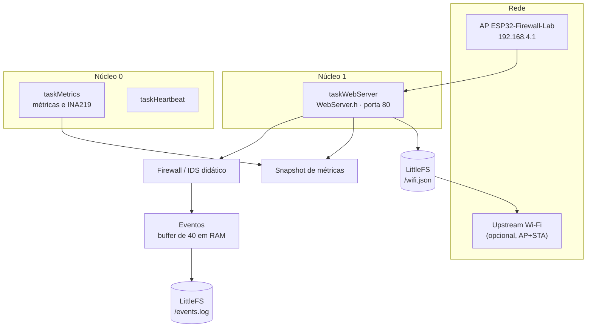

# Arquitetura

Visão geral do firmware. O detalhamento por módulo está em [arquitetura-tecnica.md](arquitetura-tecnica.md) e o diagrama original em [diagrama-arquitetura.mmd](diagrama-arquitetura.mmd).

## Componentes

## Tasks do FreeRTOS

| Task | Núcleo | Stack | Prioridade | Função |
|---|---|---|---|---|
| `taskWebServer` | 1 | 8192 | 2 | atende o HTTP e aplica as regras do firewall/IDS |
| `taskMetrics` | 0 | 4096 | 1 | lê o INA219 e atualiza o snapshot de métricas |
| `taskHeartbeat` | 0 | 3072 | 1 | sinal periódico de que o sistema está vivo |

Nenhuma task usa `delay()`: as esperas são feitas com `vTaskDelay`, então o servidor web nunca fica parado esperando métrica ou sensor.

## Fluxo de uma requisição

1. O cliente conectado ao AP faz uma requisição HTTP.
2. `taskWebServer` registra o acesso: contadores, última rota, último IP e janela de flood.
3. Se a rota não existe, conta um 404 para a detecção de varredura; se é um caminho sensível, gera evento do IDS.
4. A página ou API é montada a partir do snapshot em memória, com as saídas escapadas.
5. Eventos relevantes vão para o buffer em RAM e, se forem `WARN`, `ERROR` ou `SECURITY`, também para o `/events.log`.

## Armazenamento

| Dado | Onde | Política |
|---|---|---|
| Eventos recentes | RAM | buffer circular de 40 eventos |
| Eventos relevantes | LittleFS `/events.log` | JSON Lines; ao passar de 16 KB o arquivo é recriado |
| Wi-Fi upstream | LittleFS `/wifi.json` | gravado só pelo `/wifi/save`; passphrase nunca é devolvida |
| Senha do AP | `include/secrets.h` | definida em tempo de compilação, fora do git |

Riscos e controles de segurança: [HARDENING.md](HARDENING.md).
